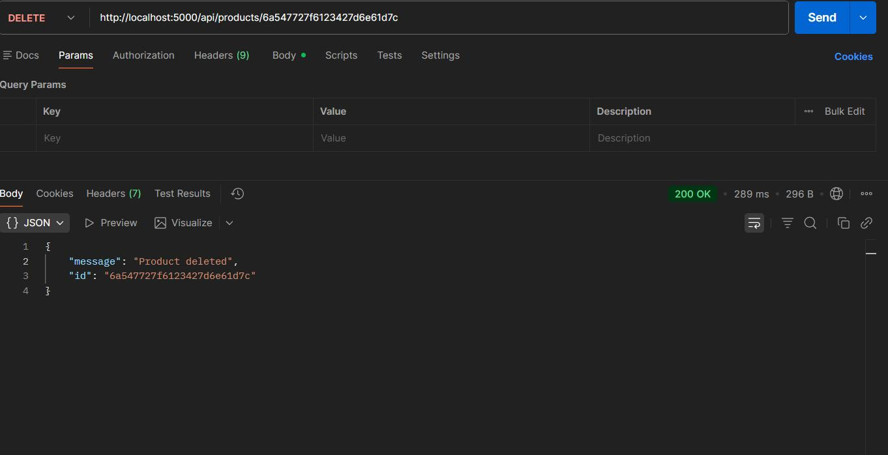

# Assignment 3: Inventory and Data Management System

**Course:** Web Dev III  
**Unit:** Unit – 3 (CO3)  
**Technology Stack:** Node.js, Express.js, MongoDB, Mongoose, dotenv  

---

## 📌 Project Overview
The **Inventory and Data Management System** is a RESTful backend application that allows a store or warehouse to manage its product catalogue — creating products, updating stock levels, searching and filtering the catalogue, and generating inventory reports through schema validation and aggregation queries.

---

## 🚀 Getting Started

### 1. Prerequisites
- [Node.js](https://nodejs.org/) (v18 or higher)
- [MongoDB](https://www.mongodb.com/) running locally on default port `27017`

### 2. Environment Setup
Create a `.env` file in `inventory-management/`:
```env
PORT=5000
MONGO_URI=mongodb://127.0.0.1:27017/INVENTORY
```

### 3. Install Dependencies
```bash
cd inventory-management
npm install
```

### 4. Seed Database (Populate Sample Data)
To populate MongoDB with the 12 sample products across 5 categories matching the assignment:
```bash
npm run seed
```

### 5. Start Server
```bash
npm start
```
The server will connect to MongoDB and start on `http://localhost:5000`.

---

## 🧪 Postman API Testing & Output Screenshots

---

### 1. Create Product
- **Method:** `POST`
- **Endpoint:** `http://localhost:5000/api/products`
- **Request Body (raw JSON):**
  ```json
  {
    "name": "Gel Pen Pack of 15",
    "sku": "STNY-PN-713",
    "category": "Stationery",
    "price": 120,
    "quantity": 40,
    "reorderLevel": 20,
    "supplier": "Cello Pens"
  }
  ```
- **Status:** `201 Created`

#### Postman Screenshot:


---

### 2. Get All Products (Filtering, Sorting & Pagination)
- **Method:** `GET`
- **Endpoint:** `http://localhost:5000/api/products`
- **Query Parameters (Optional):**
  - `page`: Page number (default: `1`)
  - `limit`: Number of items per page (default: `10`)
  - `category`: Filter by category (e.g. `Furniture`, `Electronics`)
  - `search` / `name`: Search by product name (case-insensitive regex)
  - `sortBy` & `order`: Sort field and order (`asc` or `desc`)
- **Status:** `200 OK`

#### Postman Screenshot:


---

### 3. Update Product Details
- **Method:** `PUT`
- **Endpoint:** `http://localhost:5000/api/products/:id`
- **Request Body (raw JSON):**
  ```json
  {
    "name": "Gel Pen Pack of 15",
    "sku": "STNY-PN-713",
    "category": "Stationery",
    "price": 140,
    "quantity": 60
  }
  ```
- **Status:** `200 OK`

#### Postman Screenshot:


---

### 4. Delete Product
- **Method:** `DELETE`
- **Endpoint:** `http://localhost:5000/api/products/:id`
- **Status:** `200 OK`
- **Response:**
  ```json
  {
    "message": "Product deleted",
    "id": "6a547727f6123427d6e61d7c"
  }
  ```

#### Postman Screenshot:


---

### 5. Low-Stock Alert Report
- **Method:** `GET`
- **Endpoint:** `http://localhost:5000/api/products/low-stock`
- **Description:** Returns all products where `quantity <= reorderLevel`.
- **Status:** `200 OK`

#### Postman Screenshot:


---

### 6. Category-wise Inventory Summary (Aggregation)
- **Method:** `GET`
- **Endpoint:** `http://localhost:5000/api/products/summary`
- **Description:** Uses a MongoDB aggregation pipeline to compute category-wise total products, total stock quantity, total inventory value, and average price.
- **Status:** `200 OK`

#### Postman Screenshot:


---

### 7. Stock Adjustment (Restock / Sale)
- **Method:** `PATCH`
- **Endpoint:** `http://localhost:5000/api/products/:id/stock`
- **Request Body (raw JSON):**
  ```json
  {
    "change": 10
  }
  ```
  *(Positive numbers represent restock operations; negative numbers represent sales. Stock cannot drop below zero.)*
- **Status:** `200 OK`

#### Postman Screenshot:


---

## 🛡️ Error Handling & Validation

Centralized error-handling middleware catches and formats all errors:

| Scenario | HTTP Status | Response Message |
|----------|-------------|------------------|
| **Invalid MongoDB ID** | `400 Bad Request` | `{"message": "Invalid product ID format"}` |
| **Duplicate SKU** | `400 Bad Request` | `{"message": "SKU must be unique. A product with this SKU already exists."}` |
| **Validation Failure (e.g. Negative Price/Quantity)** | `400 Bad Request` | `{"message": "Price cannot be negative"}` |
| **Insufficient Stock on Sale** | `400 Bad Request` | `{"message": "Insufficient stock. Quantity cannot be negative."}` |
| **Product Not Found** | `404 Not Found` | `{"message": "Product not found"}` |
